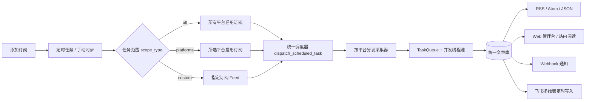
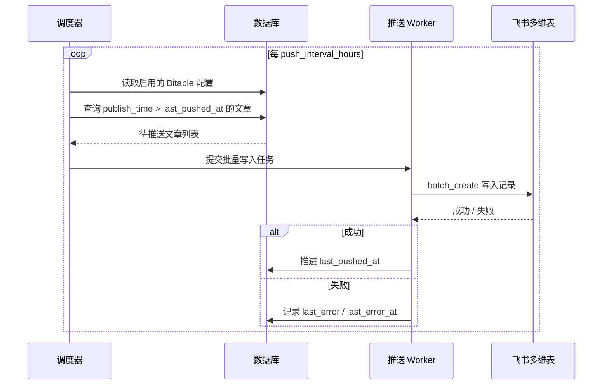
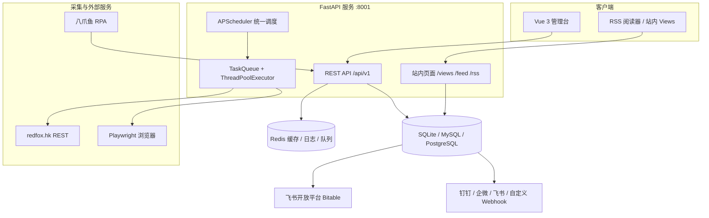
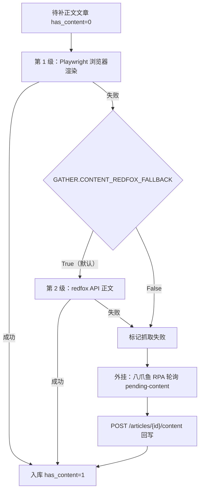
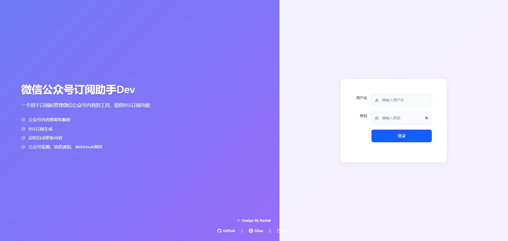
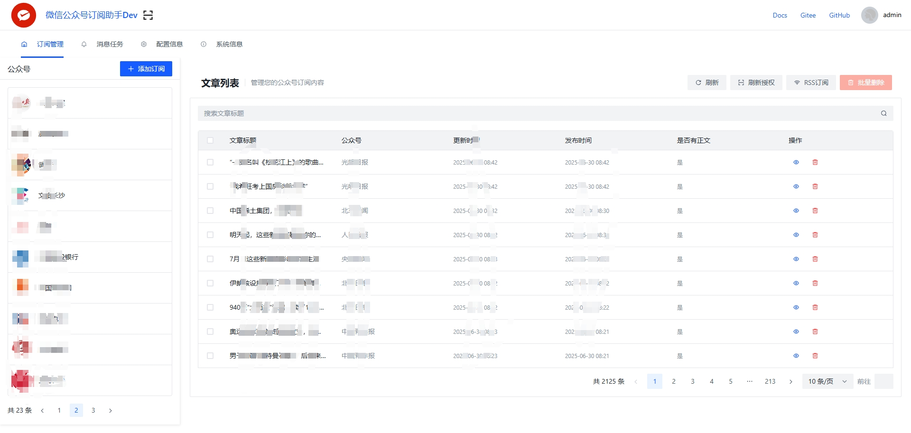
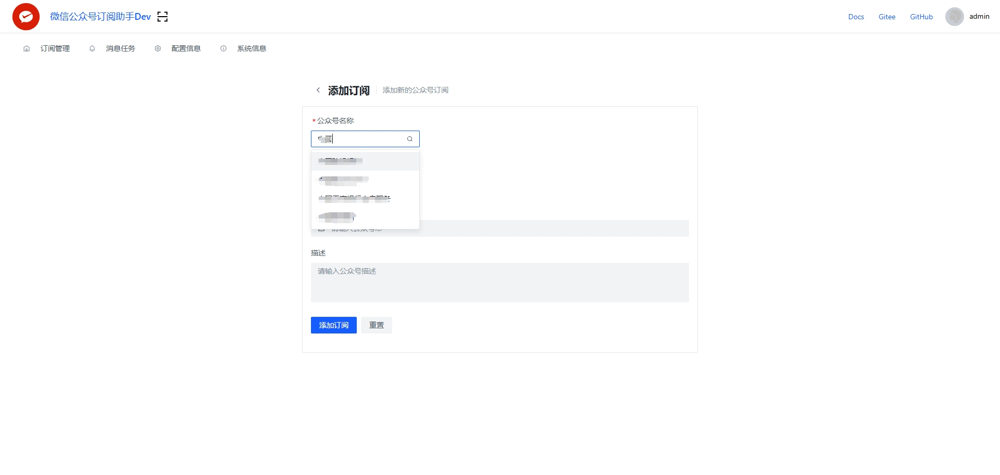
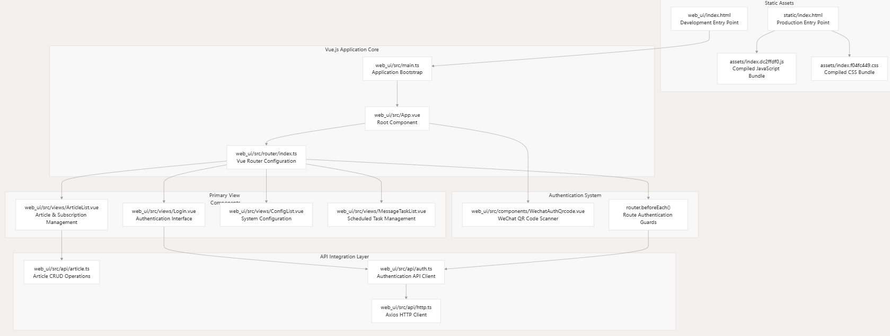

<div align=center>

<h1>WeRSS — 多平台内容订阅与 RSS / 归档服务</h1>

[]()
[]()
[]()
[](https://github.com/rachelos/we-mp-rss)

[中文](README.zh-CN.md) | [English](ReadMe.md)

自托管的多平台内容订阅服务：把 **微信公众号、小红书、抖音、B站、X、
TikTok、YouTube、Instagram** 的订阅内容统一采集入库，生成 RSS / Atom /
JSON，并通过统一调度、Webhook 通知与飞书多维表定时写入完成自动化分发与归档。

**v2 起数据层切换至 [redfox.hk](https://redfox.hk) 无状态 REST 接口** ——
无需扫码授权、可长期无人值守运行。
</div>

---

## 项目介绍

WeRSS 是一个面向团队和个人的内容聚合基础设施，解决三件事：

1. **多平台统一订阅** —— 公众号、小红书、抖音、B 站、X、TikTok、
   YouTube、Instagram 使用同一套订阅、任务和文章模型。
2. **无人值守采集** —— 基于 redfox.hk 无状态 REST 拉取列表，正文抓取采用
   Playwright → redfox 自动降级，长尾可由八爪鱼 RPA 兜底。
3. **自动分发与归档** —— 标准 RSS 输出、Webhook 通知、飞书多维表按周期
   自动写入，实现「采集 → 入库 → 分发 / 归档」全链路自动化。

本仓库是 **bulexu 维护的 fork**，上游为
[rachelos/we-mp-rss](https://github.com/rachelos/we-mp-rss)（原作者
Rachel / RachelOS）。本分支在保留上游全部能力的基础上，重点增强了
**多平台订阅、统一调度、飞书定时写入** 与 **站内阅读体验**。

---

## 核心特性

### 多平台订阅

| 平台 | 标识 | 订阅方式 | 数据来源 | 说明 |
| --- | --- | --- | --- | --- |
| 微信公众号 | `mp` | 公众号搜索 / ID | redfox 广域库 | 支持标签、级联、信源状态 |
| 小红书 | `xhs` | **关键词 / 账号** | redfox 优质库 | 账号订阅需先搜索 userId |
| 抖音 | `dy` | 关键词 | redfox 广域库 | `exactMatch=false` 模糊匹配 |
| B站 | `bili` | 关键词 | redfox 优质库 | `exactMatch=false` 模糊匹配 |
| X | `x` | 关键词 | redfox | 固定 Latest（最新）模式 |
| TikTok | `tiktok` | 关键词 | redfox | 默认美国区，按相关度返回 |
| YouTube | `youtube` | 关键词 | redfox | `continuationToken` 自动翻页 |
| Instagram | `instagram` | 关键词 | redfox | 支持图片 / 视频 / 轮播 |

> 公众号、小红书之外的平台目前以**关键词订阅**为主；均为平台级全局任务
> + 订阅级手动同步的组合。

### 采集与内容处理

- 文章列表：redfox.hk 无状态 REST（搜索 / 详情 / 作品列表）
- 正文抓取：**系统内自动降级** Playwright → 可选 Redfox；**外挂兜底**
  八爪鱼 RPA（独立运行，AK 回写）
- 缺失正文自动回填（`GATHER.CONTENT_AUTO_CHECK`）
- HTML 内容过滤规则（全局 / 按订阅，优先级 0-100）
- 文章去重、软删除 / 物理删除可配置

### RSS 与导出

- RSS 2.0，支持全文、封面、CDATA、分页大小与自定义标题 / 描述
- 同一接口支持 **RSS / XML / Atom / JSON / Markdown / TXT** 多种输出
- 站内阅读页 `/views/home`：平台 tab + 订阅列表 + 文章阅读
- 订阅列表导出 XLSX / OPML / 标签；文章导出 DOCX / PDF / Markdown / JSON / CSV

### 统一调度

- `MessageTask` 支持三种范围：**全选 / 按平台 / 自定义订阅**
- 同一 cron 表达式可同时调度多个平台，按平台自动分发到对应采集器
- 各平台启动时自动创建全局任务（默认每 6 小时），可单独调整 cron
- `TaskQueue` + `ThreadPoolExecutor` 并发采集，并发上限可配（默认 3）
- 单订阅可配置单次抓取条数 `max_fetch_count`（默认 20）

### 飞书多维表定时写入

- 可视化配置目标 Bitable、关联订阅、字段映射
- 每张表独立写入周期：**1 / 2 / 4 / 6 / 12 / 24 小时**
- 基于 `last_pushed_at` 发布时间水印增量推送，天然幂等
- 每轮限速批量扫描（默认 100 条），单表内按发布时间串行写入
- 失败记录 `last_error` / `last_error_at`，下一周期自动重试
- 支持手动推送与字段映射校验

### 通知与安全

- 通知渠道：钉钉 / 企业微信机器人 / 飞书 Webhook / 自定义 Webhook
- JWT 登录会话（默认 4320 分钟）
- Access Key（AK/SK）程序化访问
- 敏感配置遮蔽（`SAFE_HIDE_CONFIG`）

### 扩展与运维

- 环境异常统计（限流、风控、超时等按订阅追踪）
- 配置缓存：Redis / Memcached / 内存
- 数据库：SQLite（默认）/ MySQL / PostgreSQL
- 级联采集（分布式节点，可选）
- 任务队列、导出记录、Redfox 调用日志可视化

---

## 工作流程



---

## 快速开始（Docker）

镜像发布在阿里云个人版仓库：

```bash
docker run -d --name we-mp-rss \
  -p 8001:8001 \
  -v ./data:/app/data \
  --env-file ./.env \
  crpi-qp8hiqijfnilf93t.cn-hangzhou.personal.cr.aliyuncs.com/bulexu/we-mp-rss:latest
```

浏览器访问 `http://<你的 IP>:8001/`。默认账号 `admin` / `admin@123`，
**首次登录后请立即修改密码**（右上角用户菜单 → 修改密码）。

镜像**不**携带 `REDFOX_API_KEY`，通过 `.env` 注入：

```bash
# .env（一行一个，不要加引号）
REDFOX_API_KEY=ak_xxxxxxxxxxxxxxxxxxxxxxxxxxxxxxxx
LARK_APP_ID=cli_xxxxxxxxxxxx                # 可选，启用飞书多维表时填
LARK_APP_SECRET=xxxxxxxxxxxxxxxxxxxx        # 可选，启用飞书多维表时填
LARK_ENABLED=True                           # 可选，默认 False
```

### 升级

```bash
docker stop we-mp-rss && docker rm we-mp-rss
docker pull crpi-qp8hiqijfnilf93t.cn-hangzhou.personal.cr.aliyuncs.com/bulexu/we-mp-rss:latest
# 重新执行上面那条 docker run（data/ 挂在宿主机，数据不会丢）
```

---

## 使用方法

### 1. 登录与切换平台

登录后顶部「平台选择」可切换 8 个平台。每个平台有独立的二级菜单：

- **订阅管理**：查看 / 搜索 / 同步 / 启停订阅
- **添加订阅**：公众号搜索、小红书关键词 / 账号、其余平台关键词

公众号侧另有「信源状态」「级联管理」「异常统计」；跨平台功能集中在
顶部「任务监控」与「系统管理」。

### 2. 添加订阅

| 平台 | 操作路径 | 说明 |
| --- | --- | --- |
| 公众号 | 平台选择 → 公众号 → 添加订阅 | 搜索公众号或粘贴 `fakeid` / `wxId` |
| 小红书 | 平台选择 → 小红书 → 添加订阅 | 关键词直接订阅；账号需先搜索选择 userId |
| 抖音 | 平台选择 → 抖音 → 添加订阅 | 输入关键词，广域库模糊搜索 |
| B站 | 平台选择 → B站 → 添加订阅 | 输入关键词，优质库模糊搜索 |
| X | 平台选择 → X → 添加订阅 | 关键词，Latest 模式 |
| TikTok | 平台选择 → TikTok → 添加订阅 | 关键词，默认美国区 |
| YouTube | 平台选择 → YouTube → 添加订阅 | 关键词，自动翻页 |
| Instagram | 平台选择 → Instagram → 添加订阅 | 关键词，支持多图 / 视频 |

新订阅默认每 6 小时参与平台全局任务；也可在订阅行手动触发同步。

### 3. 定时任务与统一调度

进入 **任务监控 → 消息任务** 新建任务：

1. 设置 cron 表达式（如 `0 */6 * * *` 表示每 6 小时）
2. 选择抓取范围：
   - **全选**：所有平台中已启用的全部订阅
   - **按平台选择**：勾选一个或多个平台
   - **自定义选择**：只抓指定订阅
3. 可选配置 Webhook 通知与消息模板

启动时系统会为各平台自动创建全局任务（默认每 6 小时），可在任务的
cron 中单独修改；也可通过配置项 `xhs.global_cron` / `douyin.global_cron`
/ `bilibili.global_cron` / `x.global_cron` / `tiktok.global_cron` /
`youtube.global_cron` / `instagram.global_cron` 指定默认值。

> 并发上限由 `server.max_workers`（`QUEUE_MAX_WORKERS`）控制，默认 3。
> redfox 为付费 API，过大会触发限流；设为 1 即恢复串行。

### 4. RSS、站内阅读与导出

- 单订阅 RSS：`/feed/{feed_id}.rss`
- 同一订阅支持多种格式：`.rss` / `.xml` / `.atom` / `.json` / `.md` / `.txt`
- 全部订阅聚合：`/rss`
- 小红书专用别名：`/feed/xhs/{feed_id}.rss`
- 站内阅读：`/views/home`，顶部 tab 可按平台筛选订阅

导出：

- **文章导出**：DOCX / PDF / Markdown / JSON / CSV（任务监控 → 导出记录）
- **订阅导出**：跨平台 XLSX（按平台分 sheet）、公众号 OPML、标签导出

### 5. 飞书多维表定时写入

前置准备：

1. 在 [飞书开放平台](https://open.feishu.cn/app) 创建「企业自建应用」，
   取得 **App ID** 与 **App Secret**
2. 在多维表中给该应用授予 **可编辑** 权限
3. 在 `.env` 写入 `LARK_APP_ID` / `LARK_APP_SECRET` / `LARK_ENABLED=True`

添加推送目标：

1. 登录后台 → **任务监控 → 飞书多维表** → 新建
2. 填写名称、App Token、Table ID（从
   `https://feishu.cn/base/{APP_TOKEN}?table={TABLE_ID}` 复制）
3. 选择**关联订阅**（支持跨平台多选）
4. 配置**字段映射**，可用左侧字段：
   `id` / `title` / `url` / `description` / `content` / `pic_url` /
   `publish_time` / `feed_id` / `name`（订阅名）/ `art_type`
5. 选择**自动写入间隔**：1 / 2 / 4 / 6 / 12 / 24 小时

写入行为：

- 首次启用（`last_pushed_at` 为空）会推送所有命中关联订阅的有效文章
- 之后仅推送 `publish_time > last_pushed_at` 的新文章，天然去重
- 每轮最多扫描 `lark.push_batch_size` 条（默认 100），单表内按发布时间升序串行写入
- 失败不推进水印，下一周期自动重试；可在表中查看最近错误
- 支持在列表页手动推送指定文章



### 6. 通知渠道

在 `.env` 或 `config.yaml` 中配置：

```bash
DINGDING_WEBHOOK=https://oapi.dingtalk.com/robot/send?access_token=...
WECHAT_WEBHOOK=https://qyapi.weixin.qq.com/cgi-bin/webhook/send?key=...
FEISHU_WEBHOOK=https://open.feishu.cn/open-apis/bot/v2/hook/...
CUSTOM_WEBHOOK=https://your-endpoint.example.com/hook
```

飞书 Webhook（即时通知）与飞书多维表（归档）是两套独立能力。

### 7. HTML 内容过滤规则

在 **任务监控 → 过滤规则** 中配置，支持：

- 全局（不指定订阅）或按订阅生效
- 优先级 0-100，数值越大越先执行
- 按 HTML `id` / CSS `class` / CSS 选择器 / 属性 / 正则移除
- 剥离 `<script>`、`<style>`、注释等常见元素

```bash
GET    /api/filter-rules
POST   /api/filter-rules
PUT    /api/filter-rules/{id}
DELETE /api/filter-rules/{id}
```

### 8. Access Key（AK）认证

程序化访问 API 时无需暴露管理员密码：

1. 登录后台 → **系统管理 → Access Key** → 创建
2. 保存 Access Key 与 Secret（Secret 仅展示一次）

```bash
curl -H "Authorization: AK-SK {access_key}:{secret_key}" \
     http://localhost:8001/api/v1/feeds
```

```python
import requests

r = requests.get(
    "http://localhost:8001/api/v1/feeds",
    headers={"Authorization": f"AK-SK {access_key}:{secret_key}"},
)
print(r.json())
```

---

## 系统架构

- 后端：Python 3.13 + FastAPI + Uvicorn
- 前端：Vue 3 + Arco Design + Vite 8
- 数据库：SQLite（默认）/ MySQL / PostgreSQL
- 缓存 / 日志 / 队列：Redis（可选）
- 调度：APScheduler



---

## 文章抓取策略

本项目对「列表 / 正文」两类数据采用分层策略，主链路无人值守，长尾兜底走人工。

### 文章列表：redfox REST

公众号搜索、账号信息、作品列表（标题 / 发布时间 / 摘要 / 封面 / URL）统一
通过 [redfox.hk](https://redfox.hk) 无状态 REST 获取，无需登录态、无 cookie。
小红书、抖音、B站、X、TikTok、YouTube、Instagram 同样走 redfox 对应平台接口。

| 用途 | 公众号端点 |
| --- | --- |
| 按关键词搜索公众号 | `/story/api/gzh/data/searchUser` |
| 按 ID 精确查询公众号 | `/story/api/gzh/data/accountInfo` |
| 拉取公众号作品列表 | `/story/api/gzh/data/queryWorkList` |

完整模块映射见 [docs/redfox/INTEGRATION.md](docs/redfox/INTEGRATION.md)。

### 正文抓取：Playwright +（可选）Redfox + 八爪鱼 RPA



| 级别 | 触发方式 | 能力 | 限制 |
| --- | --- | --- | --- |
| **第 1 级 · Playwright** | 系统内自动，默认首选 | 真实浏览器渲染，JS / 验证码 / 关注墙可处理 | 占用浏览器进程，高频易触发风控 |
| **第 2 级 · redfox API** | 系统内自动，Playwright 失败后 | 无状态 HTTP，资源消耗低 | 部分强风控账号拿不到完整 HTML |
| **外挂 · 八爪鱼 RPA** | 人工启动，事后回写 | 真人远程操作，可绕过风控 | 需在八爪鱼客户端单独配置 |

**RPA 应用链接**：
[八爪鱼 RPA 应用](https://rpa.bazhuayu.com/shareableLink/6aa1062894a41f8dcd647ff3)

RPA 通过 AK 调用两个接口，与系统抓取主循环完全解耦：

```bash
# 1. 拉取待补齐正文的文章清单
GET  /api/v1/articles/pending-content?limit=10&feed_id=MP_WXS_xxx
Authorization: AK-SK {ak}:{sk}

# 2. 回写正文（或标记删除）
POST /api/v1/articles/{article_id}/content
Authorization: AK-SK {ak}:{sk}
Content-Type: application/json
{
  "content": "<p>正文 HTML / Markdown...</p>",
  "content_html": "<p>...</p>",
  "title": "...",
  "description": "...",
  "pic_url": "...",
  "publish_time": 1735689600,
  "deleted": false
}
```

---

## 安装（开发环境）

### 环境要求

- Python ≥ 3.13.1
- Node ≥ 20.18.3

### 后端

```bash
git clone <你的 fork 仓库> we-mp-rss
cd we-mp-rss
pip install -r requirements.txt
cp config.example.yaml config.yaml
cp .env.example .env       # 填入 REDFOX_API_KEY（必填）
python main.py -job True -init True
```

`-init` 会创建 SQLite 数据库与默认 admin 账号；`-job` 开启定时任务。
`main.py` 通过 `load_dotenv()` 自动加载 `.env`；Docker 部署中应通过
compose 的 `env_file:` 注入。

### 前端

```bash
cd web_ui
npm install --legacy-peer-deps
npm run dev          # http://localhost:3000
```

### 生产构建（同步 static/）

后端实际服务的是 `static/` 目录里的**预编译产物**：

```bash
# 1. 编译前端
cd web_ui && npm run build && cd ..

# 2. 同步 dist/ → static/
rsync -a --delete web_ui/dist/ static/

# 3. 构建 Docker 镜像
docker buildx build --platform=linux/amd64 \
  -f ./Dockerfile \
  -t crpi-qp8hiqijfnilf93t.cn-hangzhou.personal.cr.aliyuncs.com/bulexu/we-mp-rss:latest \
  .
```

> 镜像**不**包含 `.env` —— `.dockerignore` 已排除。运行时通过 `env_file:`
> 或 `-e` 注入 `REDFOX_API_KEY` / `LARK_*`。

---

## 环境变量

所有变量由 `core/config.py` 解析，支持 `config.yaml` 中的 `${VAR:-default}`
语法或操作系统环境变量。

### 核心

| 变量 | 默认值 | 含义 |
| --- | --- | --- |
| `APP_NAME` | `we-mp-rss` | 应用名 |
| `SERVER_NAME` | `we-mp-rss` | 服务名 |
| `WEB_NAME` | `WeRSS微信公众号订阅助手` | 前端显示名 |
| `ENABLE_JOB` | `True` | 是否启用定时任务 |
| `AUTO_RELOAD` | `False` | uvicorn `--reload`（开发用） |
| `THREADS` | `1` | uvicorn worker 数 |
| `QUEUE_MAX_WORKERS` | `3` | 单批采集并发线程数 |
| `PORT` | `8001` | API 端口 |
| `DB` | `sqlite:///./data/db.db` | 数据库连接串 |
| `REDIS_URL` | `redis://127.0.0.1:6379/0` | Redis 连接串（可选） |
| `SECRET_KEY` | `we-mp-rss` | JWT 签名密钥 —— **生产环境务必修改** |
| `USER_AGENT` | `Mozilla/...` | 出站请求的 User-Agent |
| `DEBUG` | `False` | 调试模式 |
| `LOG_LEVEL` | `INFO` | 日志级别 |
| `LOG_FILE` | 空 | 日志文件路径（空则输出到 stdout） |
| `SAFE_HIDE_CONFIG` | `db,secret,token,...` | 系统信息页中隐藏的 key |

### Redfox（必填）

| 变量 | 默认值 | 含义 |
| --- | --- | --- |
| `REDFOX_API_KEY` | — | **必填**。redfox.hk API Key |
| `REDFOX_ENTERPRISE` | `False` | 企业账号设为 `True`，抖音、小红书、B站关键词搜索改用实时接口 |
| `REDFOX_BASE_URL` | `https://redfox.hk` | redfox API 入口 |
| `REDFOX_TIMEOUT` | `15` | redfox 请求超时（秒） |

### 飞书多维表

| 变量 / 配置 | 默认值 | 含义 |
| --- | --- | --- |
| `LARK_ENABLED` | `False` | 全局启用飞书推送开关 |
| `LARK_APP_ID` | — | 飞书应用 App ID（`cli_...`） |
| `LARK_APP_SECRET` | — | 飞书应用 App Secret |
| `LARK_TIMEOUT` | `15` | 请求飞书 API 超时（秒） |
| `lark.push_batch_size` | `100` | 单轮每张表最多扫描的文章数 |

### Webhook 通知

| 变量 | 默认值 | 含义 |
| --- | --- | --- |
| `DINGDING_WEBHOOK` | 空 | 钉钉通知 Webhook |
| `WECHAT_WEBHOOK` | 空 | 微信群机器人 Webhook |
| `FEISHU_WEBHOOK` | 空 | 飞书 Webhook（即时通知） |
| `CUSTOM_WEBHOOK` | 空 | 自定义 Webhook |
| `WEBHOOK.CONTENT_FORMAT` | `html` | 通知中文章正文格式（`html` / `text` / `markdown`） |

### 内容采集

| 变量 | 默认值 | 含义 |
| --- | --- | --- |
| `GATHER.CONTENT` | `False` | 是否采集正文 |
| `GATHER.MODEL` | `web` | 采集模型（`web` / `api` / `app`） |
| `GATHER.CONTENT_AUTO_CHECK` | `True` | 定期回填缺失的正文 |
| `GATHER.CONTENT_AUTO_INTERVAL` | `59` | 回填间隔（分钟） |
| `GATHER.CONTENT_MODE` | `web` | 内容修正模式 |
| `GATHER.CONTENT_REDFOX_FALLBACK` | `True` | Playwright 失败后是否走 redfox 兜底 |
| `GATHER.CLEAN_HTML` | `True` | 是否清理 HTML 标签 |
| `BROWSER_TYPE` | `firefox` | Playwright 浏览器（`firefox` / `edge` / `webkit`） |
| `MAX_PAGE` | `5` | 首次添加订阅时采集的最大页数 |
| `SPAN_INTERVAL` | `10` | 单篇稿件采集间隔（秒） |
| `ARTICLE.TRUE_DELETE` | `False` | 物理删除 vs 软删除 |

### RSS 订阅源

| 变量 | 默认值 | 含义 |
| --- | --- | --- |
| `RSS_BASE_URL` | 空 | RSS 公网域名 |
| `RSS_LOCAL` | `False` | 使用本地 RSS 链接而非 `RSS_BASE_URL` |
| `RSS_TITLE` | 空 | 覆盖 feed 标题 |
| `RSS_DESCRIPTION` | 空 | 覆盖 feed 描述 |
| `RSS_COVER` | 空 | 覆盖 feed 封面 |
| `RSS_FULL_CONTEXT` | `True` | 是否在 feed 中包含全文 |
| `RSS_ADD_COVER` | `True` | 是否在 feed item 中插入封面 |
| `RSS_CDATA` | `False` | 正文用 `<![CDATA[]]>` 包裹 |
| `RSS_PAGE_SIZE` | `30` | feed 单页条数 |

### 缓存 / 导出 / 会话

| 变量 | 默认值 | 含义 |
| --- | --- | --- |
| `CACHE.DIR` | `./data/cache` | 缓存目录 |
| `CACHE.ENABLED` | `True` | 是否启用缓存 |
| `CACHE.TTL` | `3600` | 缓存过期时间（秒） |
| `EXPORT_PDF` | `False` | 是否启用 PDF 导出 |
| `EXPORT_PDF_DIR` | `./data/pdf` | PDF 输出目录 |
| `EXPORT_MARKDOWN` | `False` | 是否启用 Markdown 导出 |
| `EXPORT_MARKDOWN_DIR` | `./data/markdown` | Markdown 输出目录 |
| `TOKEN_EXPIRE_MINUTES` | `4320` | 登录会话有效期（分钟） |

### 平台默认 cron（可选）

可在 `config.yaml` 中为各平台全局任务指定默认 cron：

```yaml
xhs:
  global_cron: "0 */6 * * *"
douyin:
  global_cron: "0 */6 * * *"
bilibili:
  global_cron: "0 */6 * * *"
x:
  global_cron: "0 */6 * * *"
tiktok:
  global_cron: "0 */6 * * *"
youtube:
  global_cron: "0 */6 * * *"
instagram:
  global_cron: "0 */6 * * *"
```

---

## 界面截图

- 登录界面
  <br/>
- 主界面
  <br/>
- 添加订阅（redfox 搜索）
  <br/>
- 前端架构
  <br/>

---

## 常见问题

1. **默认账号密码？** 
`admin` / `admin@123`，首次登录后请立即修改。

2. **`/mps/search` 没结果？** 
redfox.hk 公共库只收录热门公众号。冷门账号请在
添加订阅时直接粘贴 `fakeid`（Base64 编码的 `bizInfo`）或 `wxId`。

3. **去哪里申请 `REDFOX_API_KEY`？** 
在[redfox.hk](https://redfox.hk?source=redfox_api_md) 注册后到[API Keys](https://redfox.hk/settings/api-keys?source=redfox_api_md) 创建。

4. **拉了新镜像后后台界面没变化？** 
后端服务的是 `static/` 里的预编译产物，如果只更新镜像但没重建 `web_ui/dist/ → static/`，UI 仍是旧版。请按上文**生产构建** 一节重新执行三步。

5. **搜索返回空但 Redfox 日志也是空的？** 
`REDFOX_API_KEY 未配置` 是在`_headers()` 阶段抛出的（在 `_post()` 之前），不会写日志。请看 uvicorn stdout 或后台「系统信息」页里的 redfox 状态块。

6. **飞书定时写入没生效？** 
检查四处：
   1. `.env` 里 `LARK_ENABLED=True` 且 `LARK_APP_ID` / `LARK_APP_SECRET`不为空
   1. 该 Bitable 行 `enabled=True` 且「关联订阅」包含文章所属的 Feed
   2.  `push_interval_hours` 不为 0（可选 1/2/4/6/12/24）
   3.  查看 `last_error` 字段与 uvicorn stdout 中的 `[lark]` 日志

7. **为什么定时任务只抓了一部分平台？** 
检查任务的「抓取范围」：`全选` 才会覆盖所有平台；`按平台选择` 只抓勾选的平台；`自定义选择` 只抓指定订阅。

8. **怎么改数据库？** 
设置 `DB` 环境变量或编辑 `config.yaml` 的 `db:`：
```ini
# SQLite
DB=sqlite:///./data/db.db
# MySQL
DB=mysql+pymysql://<user>:<password>@<host>/<db>?charset=utf8mb4
# PostgreSQL
DB=postgresql://<user>:<password>@<host>/<db>
```

---

## 关联文档

- 升级到 v2（redfox 迁移）：[docs/redfox/INTEGRATION.md](docs/redfox/INTEGRATION.md)
- Access Key 鉴权：[docs/AK_Authentication_Guide.md](docs/AK_Authentication_Guide.md)
- 级联系统（分布式采集）：
  [docs/CASCADE_QUICKSTART.md](docs/CASCADE_QUICKSTART.md) /
  [docs/CASCADE_GUIDE.md](docs/CASCADE_GUIDE.md)
- 配置缓存：[docs/cache-config.md](docs/cache-config.md)
- Webhook 自定义头：[docs/headers_cookies_feature.md](docs/headers_cookies_feature.md)
- Web UI 入门：[docs/webui-quickstart.md](docs/webui-quickstart.md)
- 环境异常统计：[docs/webui-env-exception-stats.md](docs/webui-env-exception-stats.md)
- 贡献指南：[CONTRIBUTING.md](CONTRIBUTING.md)
- 安全策略：[SECURITY.md](SECURITY.md)
- 故障排查：[TROUBLESHOOTING_CASCADE.md](TROUBLESHOOTING_CASCADE.md)
- 级联配置修复：[FIX_CASCADE_CONFIG.md](FIX_CASCADE_CONFIG.md)

---

## 鸣谢

本项目基于 **<https://github.com/rachelos/we-mp-rss>** 开发，感谢 RachelOS与其贡献者。

同时感谢以下服务与开源项目：

- [redfox.hk](https://redfox.hk)：多平台内容数据接口
- [八爪鱼 RPA](https://rpa.bazhuayu.com/)：正文抓取人工兜底

上游 README 与鸣谢见
[rachelos/we-mp-rss](https://github.com/rachelos/we-mp-rss)。
本分支所有新增能力与问题修复的版权归 bulexu 与贡献者所有，基础能力版权归属上游作者。

---

## 许可

MIT — 详见 [LICENSE](LICENSE)。
