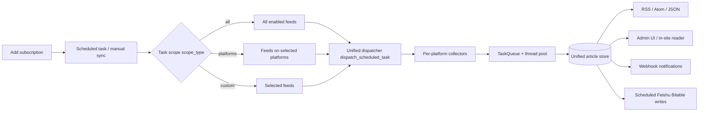
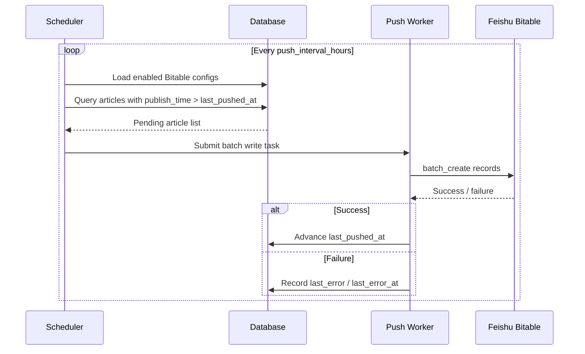
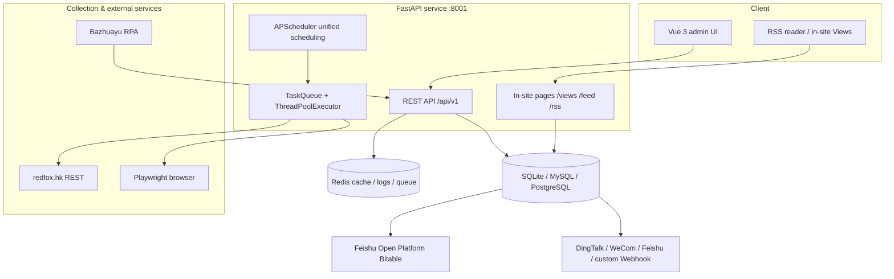
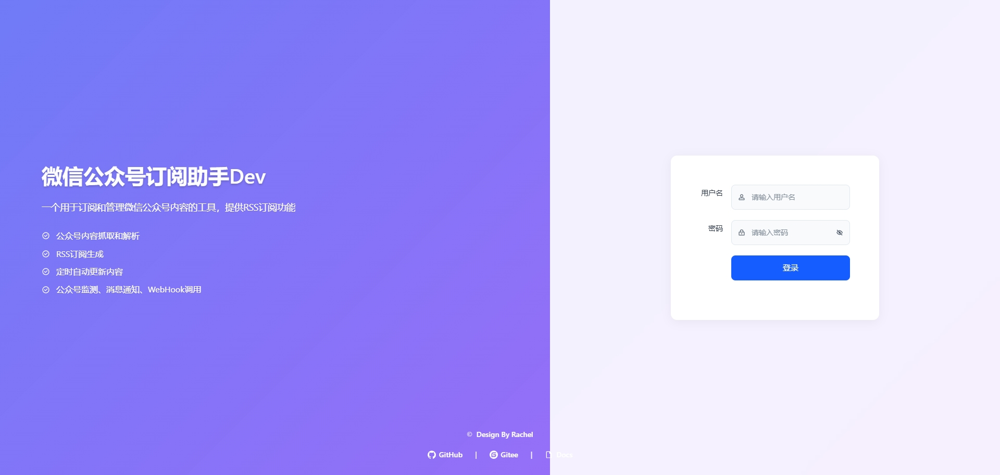
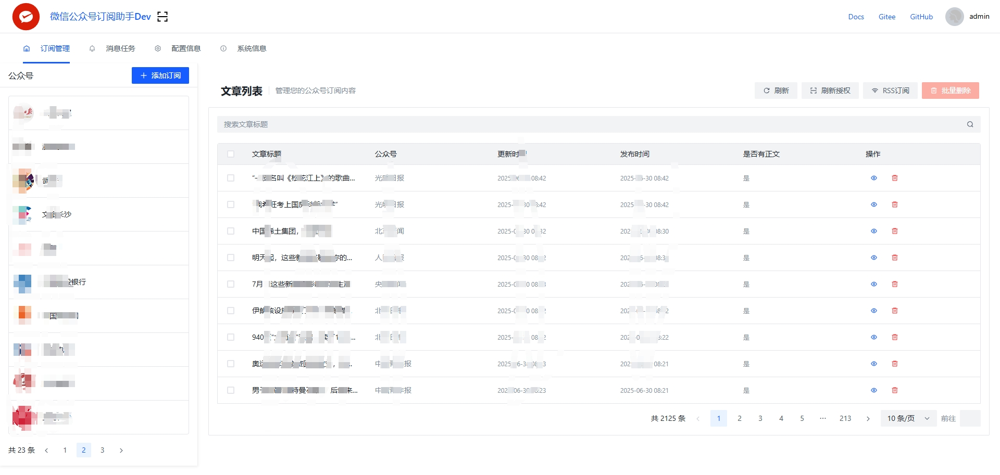
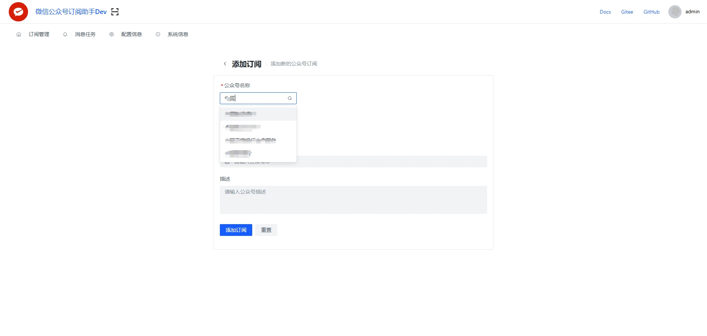
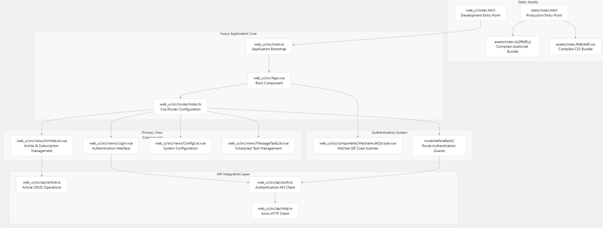

<div align=center>

<h1>WeRSS — Multi-platform Content Subscriptions with RSS &amp; Archiving (bulexu fork)</h1>

[]()
[]()
[]()
[](https://github.com/rachelos/we-mp-rss)

[中文](README.zh-CN.md) | [English](ReadMe.md)

A self-hosted multi-platform content subscription service. Collect content
from **WeChat Official Accounts, Xiaohongshu, Douyin, Bilibili, X, TikTok,
YouTube, and Instagram** into one unified article store, then publish it as
RSS / Atom / JSON and automate distribution with unified scheduling, Webhook
notifications, and scheduled Feishu Bitable writes.

**Since v2 the data layer runs against the stateless
[redfox.hk](https://redfox.hk) REST API** — no QR-code session, no cookie
expiry, and safe for long-running unattended deployments.
</div>

---

## About This Project

WeRSS is content aggregation infrastructure for teams and individuals. It
solves three problems:

1. **One subscription model for many platforms** — WeChat Official Accounts,
   Xiaohongshu, Douyin, Bilibili, X, TikTok, YouTube, and Instagram share the
   same subscription, scheduling, and article model.
2. **Unattended collection** — lists come from the stateless redfox.hk REST
   API; article bodies use Playwright with automatic redfox fallback, and a
   long-tail manual fallback via Bazhuayu RPA.
3. **Automated distribution & archiving** — standard RSS output, Webhook
   notifications, and periodic Feishu Bitable writes form an
   end-to-end "collect → store → distribute / archive" pipeline.

This repository is a **bulexu-maintained fork**. Upstream is
[rachelos/we-mp-rss](https://github.com/rachelos/we-mp-rss) (original author:
Rachel / RachelOS). This branch keeps all upstream capabilities and focuses on
**multi-platform subscriptions, unified scheduling, scheduled Feishu writes**,
and an improved in-site reading experience.

---

## Core Capabilities

### Multi-platform subscriptions

| Platform | Key | Subscription mode | Data source | Notes |
| --- | --- | --- | --- | --- |
| WeChat Official Account | `mp` | Account search / ID | redfox broad library | Tags, cascade, source health |
| Xiaohongshu | `xhs` | **Keyword / account** | redfox quality library | Account mode searches userId first |
| Douyin | `dy` | Keyword | redfox broad library | `exactMatch=false` fuzzy search |
| Bilibili | `bili` | Keyword | redfox quality library | `exactMatch=false` fuzzy search |
| X | `x` | Keyword | redfox | Fixed Latest mode |
| TikTok | `tiktok` | Keyword | redfox | US region by default, relevance order |
| YouTube | `youtube` | Keyword | redfox | Automatic `continuationToken` paging |
| Instagram | `instagram` | Keyword | redfox | Images, videos, and carousels |

> Platforms other than WeChat and Xiaohongshu currently focus on **keyword
> subscriptions**, combining a platform-level global task with per-feed manual
> sync.

### Collection & content processing

- Article lists: stateless redfox.hk REST (search / detail / works list)
- Article body: **in-system auto-degrade** Playwright → optional Redfox;
  **out-of-band fallback** via Bazhuayu RPA (independent, AK write-back)
- Automatic backfill for missing bodies (`GATHER.CONTENT_AUTO_CHECK`)
- HTML content filter rules (global / per-feed, priority 0-100)
- Article deduplication, configurable soft delete / hard delete

### RSS & export

- RSS 2.0 with full text, covers, CDATA, page size, and custom title / description
- One endpoint supports **RSS / XML / Atom / JSON / Markdown / TXT**
- In-site reader at `/views/home`: platform tabs + subscription list + article reading
- Subscription export: XLSX / OPML / tags; article export: DOCX / PDF / Markdown / JSON / CSV

### Unified scheduling

- `MessageTask` supports three scopes: **all / by platform / custom feeds**
- One cron expression can schedule multiple platforms; dispatch is automatic
  per platform
- Global tasks are created per platform at startup (every 6 hours by default)
  and each cron can be tuned independently
- `TaskQueue` + `ThreadPoolExecutor` concurrent collection; worker limit is
  configurable (default 3)
- Per-feed `max_fetch_count` (default 20)

### Scheduled Feishu Bitable writes

- Visual configuration of target Bitable, linked feeds, and field mapping
- Independent write interval per table: **1 / 2 / 4 / 6 / 12 / 24 hours**
- Incremental push based on the `last_pushed_at` publish-time watermark, so
  writes are idempotent by design
- Rate-limited batch scan per round (default 100 items); serial writes per
  table ordered by publish time
- Failures record `last_error` / `last_error_at` and retry on the next cycle
- Manual push and field-mapping validation supported

### Notifications & security

- Channels: DingTalk / WeCom bot / Feishu Webhook / custom Webhook
- JWT login sessions (default 4320 minutes)
- Access Key (AK/SK) for programmatic access
- Sensitive config masking (`SAFE_HIDE_CONFIG`)

### Extensibility & operations

- Environment exception statistics (rate limiting, risk control, timeouts per feed)
- Configuration cache: Redis / Memcached / in-memory
- Database: SQLite (default) / MySQL / PostgreSQL
- Cascade collection (distributed nodes, optional)
- Task queue, export records, and redfox call logs in the admin UI

---

## How It Works



---

## Quick Start (Docker)

The image is published to the Aliyun personal registry:

```bash
docker run -d --name we-mp-rss \
  -p 8001:8001 \
  -v ./data:/app/data \
  --env-file ./.env \
  crpi-qp8hiqijfnilf93t.cn-hangzhou.personal.cr.aliyuncs.com/bulexu/we-mp-rss:latest
```

Then visit `http://<your-ip>:8001/`. Default credentials: `admin` /
`admin@123` — **change them on first login** (top-right user menu →
Change Password).

The image does **not** bundle `REDFOX_API_KEY`. Pass it via `.env`:

```bash
# .env (one line per key, no quotes)
REDFOX_API_KEY=ak_xxxxxxxxxxxxxxxxxxxxxxxxxxxxxxxx
LARK_APP_ID=cli_xxxxxxxxxxxx                # Optional, required for Feishu Bitable
LARK_APP_SECRET=xxxxxxxxxxxxxxxxxxxx        # Optional, required for Feishu Bitable
LARK_ENABLED=True                           # Optional, default False
```

### Upgrade

```bash
docker stop we-mp-rss && docker rm we-mp-rss
docker pull crpi-qp8hiqijfnilf93t.cn-hangzhou.personal.cr.aliyuncs.com/bulexu/we-mp-rss:latest
# re-run the docker run command above (data/ is on a host volume — preserved)
```

---

## Usage

### 1. Sign in and switch platforms

After login, use **Platform Selection** in the top bar to switch between the
eight platforms. Each platform has its own sub-navigation:

- **Subscriptions**: view / search / sync / enable / disable feeds
- **Add subscription**: WeChat account search, Xiaohongshu keyword / account,
  keyword subscriptions for the rest

WeChat also exposes **Source Health**, **Cascade**, and **Exception Stats**.
Cross-platform features live under **Task Monitor** and **System** in the top bar.

### 2. Add subscriptions

| Platform | Path | Notes |
| --- | --- | --- |
| WeChat | Platform → WeChat → Add Subscription | Search an account or paste `fakeid` / `wxId` |
| Xiaohongshu | Platform → Xiaohongshu → Add Subscription | Keyword direct; account mode searches userId first |
| Douyin | Platform → Douyin → Add Subscription | Keyword, broad-library fuzzy search |
| Bilibili | Platform → Bilibili → Add Subscription | Keyword, quality-library fuzzy search |
| X | Platform → X → Add Subscription | Keyword, Latest mode |
| TikTok | Platform → TikTok → Add Subscription | Keyword, US region by default |
| YouTube | Platform → YouTube → Add Subscription | Keyword, automatic paging |
| Instagram | Platform → Instagram → Add Subscription | Keyword, images / videos / carousels |

New feeds join their platform's global task (every 6 hours by default) and can
also be synced manually from the subscription row.

### 3. Scheduled tasks and unified scheduling

Open **Task Monitor → Message Tasks** and create a task:

1. Set a cron expression (e.g. `0 */6 * * *` for every 6 hours)
2. Choose the scope:
   - **All**: every enabled feed across all platforms
   - **By platform**: only feeds on the selected platforms
   - **Custom**: only the selected feeds
3. Optionally configure Webhook notifications and a message template

At startup the system creates a global task per platform (every 6 hours by
default). Adjust its cron in the task, or set defaults via
`xhs.global_cron` / `douyin.global_cron` / `bilibili.global_cron` /
`x.global_cron` / `tiktok.global_cron` / `youtube.global_cron` /
`instagram.global_cron`.

> Concurrency is controlled by `server.max_workers` (`QUEUE_MAX_WORKERS`,
> default 3). redfox is a paid API; higher values may trigger rate limits.
> Set it to 1 for fully serial collection.

### 4. RSS, in-site reading, and export

- Per-feed RSS: `/feed/{feed_id}.rss`
- Multiple formats from the same endpoint: `.rss` / `.xml` / `.atom` /
  `.json` / `.md` / `.txt`
- Aggregated feed: `/rss`
- Xiaohongshu alias: `/feed/xhs/{feed_id}.rss`
- In-site reader: `/views/home`, with platform tabs filtering subscriptions

Export:

- **Articles**: DOCX / PDF / Markdown / JSON / CSV (Task Monitor → Export Records)
- **Subscriptions**: cross-platform XLSX (one sheet per platform), WeChat OPML,
  tag export

### 5. Scheduled Feishu Bitable writes

Prerequisites:

1. Create a **Custom App** at [Feishu Open Platform](https://open.feishu.cn/app)
   and obtain the **App ID** and **App Secret**
2. Grant the app **editable** permission on the target Bitable
3. Set `LARK_APP_ID` / `LARK_APP_SECRET` / `LARK_ENABLED=True` in `.env`

Add a push target:

1. Sign in → **Task Monitor → Feishu Bitable** → **New**
2. Fill in the name, App Token, and Table ID (copied from
   `https://feishu.cn/base/{APP_TOKEN}?table={TABLE_ID}`)
3. Select **linked feeds** (cross-platform multi-select supported)
4. Configure **field mapping** — available left-hand keys:
   `id` / `title` / `url` / `description` / `content` / `pic_url` /
   `publish_time` / `feed_id` / `name` (feed name) / `art_type`
5. Choose the **auto-write interval**: 1 / 2 / 4 / 6 / 12 / 24 hours

Write behavior:

- On first enable (`last_pushed_at` is empty), every valid article in the
  linked feeds is pushed
- Afterwards only articles with `publish_time > last_pushed_at` are pushed,
  making writes naturally deduplicated
- Each round scans at most `lark.push_batch_size` articles (default 100) and
  writes serially per table in publish-time order
- Failures do not advance the watermark and retry on the next cycle; the last
  error is visible on the row
- Manual push of selected articles is supported from the list page



### 6. Notification channels

Configure in `.env` or `config.yaml`:

```bash
DINGDING_WEBHOOK=https://oapi.dingtalk.com/robot/send?access_token=...
WECHAT_WEBHOOK=https://qyapi.weixin.qq.com/cgi-bin/webhook/send?key=...
FEISHU_WEBHOOK=https://open.feishu.cn/open-apis/bot/v2/hook/...
CUSTOM_WEBHOOK=https://your-endpoint.example.com/hook
```

The Feishu Webhook (instant notification) and Feishu Bitable (archiving) are
two independent features.

### 7. HTML content filter rules

Configure under **Task Monitor → Filter Rules**:

- Global (no feed specified) or per-feed
- Priority 0-100; higher runs first
- Remove by HTML `id` / CSS `class` / CSS selector / attribute / regex
- Strip `<script>`, `<style>`, comments, and other common elements

```bash
GET    /api/filter-rules
POST   /api/filter-rules
PUT    /api/filter-rules/{id}
DELETE /api/filter-rules/{id}
```

### 8. Access Key (AK) authentication

Use AKs for programmatic API access without exposing the admin password:

1. Sign in → **System → Access Key** → **Create**
2. Save both the Access Key and Secret (the Secret is shown only once)

```bash
curl -H "Authorization: AK-SK {access_key}:{secret_key}" \
     http://localhost:8001/api/v1/feeds
```

```python
import requests

r = requests.get(
    "http://localhost:8001/api/v1/feeds",
    headers={"Authorization": f"AK-SK {access_key}:{secret_key}"},
)
print(r.json())
```

---

## System Architecture

- Backend: Python 3.13 + FastAPI + Uvicorn
- Frontend: Vue 3 + Arco Design + Vite 8
- Database: SQLite (default) / MySQL / PostgreSQL
- Cache / logs / queue: Redis (optional)
- Scheduling: APScheduler



---

## Article Scraping Strategy

The project uses a layered strategy for two distinct data types — **article
list** and **article body** — keeping the main pipeline unattended while
reserving human-in-the-loop fallback for the long tail.

### Article list: redfox REST

Account search, account metadata, and the article list (title / publish time /
summary / cover / URL) all come from
[redfox.hk](https://redfox.hk) stateless REST. No login session, no cookies.
Xiaohongshu, Douyin, Bilibili, X, TikTok, YouTube, and Instagram use the
corresponding redfox platform endpoints.

| Concern | WeChat endpoint |
| --- | --- |
| Search an account by keyword | `/story/api/gzh/data/searchUser` |
| Get an account by ID | `/story/api/gzh/data/accountInfo` |
| Get article list for an account | `/story/api/gzh/data/queryWorkList` |

Full module map: [docs/redfox/INTEGRATION.md](docs/redfox/INTEGRATION.md).

### Article body: Playwright + (optional) Redfox + Bazhuayu RPA

```mermaid
flowchart TD
    A["Article needs body has_content=0"] --> B["Tier 1: Playwright rendering"]
    B -->|Success| OK["Store has_content=1"]
    B -->|Failure| C{"GATHER.CONTENT_REDFOX_FALLBACK"}
    C -->|True (default)| D["Tier 2: redfox API body"]
    C -->|False| FAIL["Mark as failed"]
    D -->|Success| OK
    D -->|Failure| FAIL
    FAIL --> E["Out-of-band: Bazhuayu RPA polls pending-content"]
    E --> F["POST /articles/{id}/content write-back"]
    F --> OK
```

| Tier | Trigger | Strengths | Limits |
| --- | --- | --- | --- |
| **Tier 1 · Playwright** | In-system, default preferred | Real browser rendering; handles JS, CAPTCHA, attention walls | Browser process overhead; high-frequency scraping triggers anti-bot |
| **Tier 2 · redfox API** | In-system, after Playwright failures | Stateless HTTP, low resource cost | Some heavily protected accounts return incomplete HTML |
| **Out-of-band · Bazhuayu RPA** | Manually started; retroactive writes | Human-in-the-loop, can bypass anti-bot | Must be configured and run inside the Bazhuayu client |

**RPA application link**:
**[Bazhuayu RPA application](https://rpa.bazhuayu.com/shareableLink/6aa1062894a41f8dcd647ff3)**

The RPA uses an Access Key to call two endpoints, fully decoupled from the
system scraping loop:

```bash
# 1. Pull articles that need body content
GET  /api/v1/articles/pending-content?limit=10&feed_id=MP_WXS_xxx
Authorization: AK-SK {ak}:{sk}

# 2. Write the body content (or mark deleted)
POST /api/v1/articles/{article_id}/content
Authorization: AK-SK {ak}:{sk}
Content-Type: application/json
{
  "content": "<p>Body HTML / Markdown ...</p>",
  "content_html": "<p>...</p>",
  "title": "...",
  "description": "...",
  "pic_url": "...",
  "publish_time": 1735689600,
  "deleted": false
}
```

---

## Installation (Development)

### Requirements

- Python ≥ 3.13.1
- Node ≥ 20.18.3

### Backend

```bash
git clone <your-fork-url> we-mp-rss
cd we-mp-rss
pip install -r requirements.txt
cp config.example.yaml config.yaml
cp .env.example .env       # then fill in REDFOX_API_KEY (required)
python main.py -job True -init True
```

The `-init` flag creates the SQLite DB and the default `admin` user. The
`-job` flag enables the scheduler. `main.py` auto-loads `.env` via
`load_dotenv()` for direct dev runs; in Docker the key is injected via
`env_file:` (see `compose/*.yaml`).

### Frontend

```bash
cd web_ui
npm install --legacy-peer-deps
npm run dev          # http://localhost:3000
```

### Production build (static/ sync)

The backend serves the **prebuilt** frontend from `static/`:

```bash
# 1. Build the SPA
cd web_ui && npm run build && cd ..

# 2. Sync dist/ → static/
rsync -a --delete web_ui/dist/ static/

# 3. Build the Docker image
docker buildx build --platform=linux/amd64 \
  -f ./Dockerfile \
  -t crpi-qp8hiqijfnilf93t.cn-hangzhou.personal.cr.aliyuncs.com/bulexu/we-mp-rss:latest \
  .
```

> The image does **not** carry `.env` — `.dockerignore` excludes it. Inject
> `REDFOX_API_KEY` / `LARK_*` at runtime via `env_file:` or `-e`.

---

## Environment Variables

All variables are read by `core/config.py` and can be set in `config.yaml`
(via the `${VAR:-default}` syntax) or as OS env vars.

### Core

| Variable | Default | Description |
| --- | --- | --- |
| `APP_NAME` | `we-mp-rss` | Application name |
| `SERVER_NAME` | `we-mp-rss` | Server name |
| `WEB_NAME` | `WeRSS微信公众号订阅助手` | Frontend display name |
| `ENABLE_JOB` | `True` | Whether to enable scheduled tasks |
| `AUTO_RELOAD` | `False` | uvicorn `--reload` for dev |
| `THREADS` | `1` | uvicorn worker count |
| `QUEUE_MAX_WORKERS` | `3` | Concurrency per collection batch |
| `PORT` | `8001` | API port |
| `DB` | `sqlite:///./data/db.db` | Database URL |
| `REDIS_URL` | `redis://127.0.0.1:6379/0` | Redis URL (optional) |
| `SECRET_KEY` | `we-mp-rss` | JWT signing key — **change in production** |
| `USER_AGENT` | `Mozilla/...` | User-Agent for outbound requests |
| `DEBUG` | `False` | Debug mode |
| `LOG_LEVEL` | `INFO` | Log level |
| `LOG_FILE` | empty | Log file path (stdout if empty) |
| `SAFE_HIDE_CONFIG` | `db,secret,token,...` | Keys hidden in the System Info page |

### Redfox (required)

| Variable | Default | Description |
| --- | --- | --- |
| `REDFOX_API_KEY` | — | **Required**. redfox.hk API key |
| `REDFOX_BASE_URL` | `https://redfox.hk` | redfox API base URL |
| `REDFOX_TIMEOUT` | `15` | redfox request timeout (seconds) |

### Feishu Bitable

| Variable / config | Default | Description |
| --- | --- | --- |
| `LARK_ENABLED` | `False` | Global switch for Feishu push |
| `LARK_APP_ID` | — | Feishu App ID (`cli_...`) |
| `LARK_APP_SECRET` | — | Feishu App Secret |
| `LARK_TIMEOUT` | `15` | Feishu API request timeout (seconds) |
| `lark.push_batch_size` | `100` | Max articles scanned per table per round |

### Webhook notifications

| Variable | Default | Description |
| --- | --- | --- |
| `DINGDING_WEBHOOK` | empty | DingTalk notification webhook |
| `WECHAT_WEBHOOK` | empty | WeCom bot webhook |
| `FEISHU_WEBHOOK` | empty | Feishu webhook (instant notification) |
| `CUSTOM_WEBHOOK` | empty | Custom webhook |
| `WEBHOOK.CONTENT_FORMAT` | `html` | Article body format for webhooks (`html` / `text` / `markdown`) |

### Content collection

| Variable | Default | Description |
| --- | --- | --- |
| `GATHER.CONTENT` | `False` | Fetch full article body |
| `GATHER.MODEL` | `web` | Collection model (`web` / `api` / `app`) |
| `GATHER.CONTENT_AUTO_CHECK` | `True` | Periodically backfill missing bodies |
| `GATHER.CONTENT_AUTO_INTERVAL` | `59` | Backfill interval (minutes) |
| `GATHER.CONTENT_MODE` | `web` | Content correction mode |
| `GATHER.CONTENT_REDFOX_FALLBACK` | `True` | Fall back to redfox after Playwright failures |
| `GATHER.CLEAN_HTML` | `True` | Clean HTML tags |
| `BROWSER_TYPE` | `firefox` | Playwright browser (`firefox` / `edge` / `webkit`) |
| `MAX_PAGE` | `5` | Max pages fetched when first adding a subscription |
| `SPAN_INTERVAL` | `10` | Delay between article fetches (seconds) |
| `ARTICLE.TRUE_DELETE` | `False` | Hard-delete vs. soft-delete articles |

### RSS feed

| Variable | Default | Description |
| --- | --- | --- |
| `RSS_BASE_URL` | empty | Public RSS domain |
| `RSS_LOCAL` | `False` | Use local RSS links instead of `RSS_BASE_URL` |
| `RSS_TITLE` | empty | Override feed title |
| `RSS_DESCRIPTION` | empty | Override feed description |
| `RSS_COVER` | empty | Override feed cover image |
| `RSS_FULL_CONTEXT` | `True` | Include full article body in feed |
| `RSS_ADD_COVER` | `True` | Include cover image in feed items |
| `RSS_CDATA` | `False` | Wrap content in `<![CDATA[]]>` |
| `RSS_PAGE_SIZE` | `30` | Feed item count per page |

### Cache / export / session

| Variable | Default | Description |
| --- | --- | --- |
| `CACHE.DIR` | `./data/cache` | Cache directory |
| `CACHE.ENABLED` | `True` | Enable cache |
| `CACHE.TTL` | `3600` | Cache TTL (seconds) |
| `EXPORT_PDF` | `False` | Enable PDF export |
| `EXPORT_PDF_DIR` | `./data/pdf` | PDF output directory |
| `EXPORT_MARKDOWN` | `False` | Enable Markdown export |
| `EXPORT_MARKDOWN_DIR` | `./data/markdown` | Markdown output directory |
| `TOKEN_EXPIRE_MINUTES` | `4320` | Login session validity (minutes) |

### Platform default cron (optional)

Set default crons for platform-level global tasks in `config.yaml`:

```yaml
xhs:
  global_cron: "0 */6 * * *"
douyin:
  global_cron: "0 */6 * * *"
bilibili:
  global_cron: "0 */6 * * *"
x:
  global_cron: "0 */6 * * *"
tiktok:
  global_cron: "0 */6 * * *"
youtube:
  global_cron: "0 */6 * * *"
instagram:
  global_cron: "0 */6 * * *"
```

---

## Screenshots

- Login Interface
  <br/>
- Main Interface
  <br/>
- Add Subscription (powered by redfox search)
  <br/>
- Frontend Architecture
  <br/>

---

## FAQ

**Default credentials?** `admin` / `admin@123` — change on first login.

**`/mps/search` returns empty?** The redfox.hk public library only indexes
"hot" accounts. For unindexed accounts, paste the `fakeid` (Base64 `bizInfo`)
or `wxId` directly when adding a subscription.

**Where do I get a `REDFOX_API_KEY`?** Register at
[redfox.hk](https://redfox.hk?source=redfox_api_md) and create one in
[API Keys](https://redfox.hk/settings/api-keys?source=redfox_api_md).

**Why doesn't the admin UI show my changes after pulling a new image?**
The backend serves the prebuilt frontend from `static/`. Rebuild and sync
`web_ui/dist/ → static/` using the sequence above.

**Feishu scheduled writes are not working?** Check four things:
1. `.env` has `LARK_ENABLED=True` and non-empty `LARK_APP_ID` /
   `LARK_APP_SECRET`
2. The Bitable row is `enabled=True` and **linked feeds** include the
   article's feed
3. `push_interval_hours` is not 0 (allowed: 1/2/4/6/12/24)
4. Check the row's `last_error` and the `[lark]` lines in uvicorn stdout

**Why does a scheduled task only collect some platforms?** Check its scope:
`All` covers every platform, `By platform` only the selected platforms, and
`Custom` only the selected feeds.

**How do I change the database?** Set the `DB` env var or edit `db:` in
`config.yaml`:

```ini
# SQLite
DB=sqlite:///./data/db.db
# MySQL
DB=mysql+pymysql://<user>:<password>@<host>/<db>?charset=utf8mb4
# PostgreSQL
DB=postgresql://<user>:<password>@<host>/<db>
```

---

## Related Documents

- Upgrade to v2 (redfox migration): [docs/redfox/INTEGRATION.md](docs/redfox/INTEGRATION.md)
- Access Key auth: [docs/AK_Authentication_Guide.md](docs/AK_Authentication_Guide.md)
- Cascade system (distributed collection):
  [docs/CASCADE_QUICKSTART.md](docs/CASCADE_QUICKSTART.md) /
  [docs/CASCADE_GUIDE.md](docs/CASCADE_GUIDE.md)
- Configuration cache: [docs/cache-config.md](docs/cache-config.md)
- Webhook custom headers: [docs/headers_cookies_feature.md](docs/headers_cookies_feature.md)
- Web UI quickstart: [docs/webui-quickstart.md](docs/webui-quickstart.md)
- Environment exception stats:
  [docs/webui-env-exception-stats.md](docs/webui-env-exception-stats.md)
- Contributing guide: [CONTRIBUTING.md](CONTRIBUTING.md)
- Security policy: [SECURITY.md](SECURITY.md)
- Cascade troubleshooting: [TROUBLESHOOTING_CASCADE.md](TROUBLESHOOTING_CASCADE.md)
- Cascade config fix: [FIX_CASCADE_CONFIG.md](FIX_CASCADE_CONFIG.md)

---

## Acknowledgements

This project is based on **<https://github.com/rachelos/we-mp-rss>**. Thanks to
RachelOS and the following contributors (in no particular order):

> **cyChaos, 子健MeLift, 晨阳, 童总, 胜宇, 军亮, 余光, 一路向北,
> 水煮土豆丝, 人可, 须臾, 澄明, 五梭, Jarvis, 三三, 哈基米, 苹果**

Thanks also to the services and open-source projects that make this possible:

- [redfox.hk](https://redfox.hk): multi-platform content data API
- [Bazhuayu RPA](https://rpa.bazhuayu.com/): manual fallback for article bodies
- [FastAPI](https://fastapi.tiangolo.com/) / [APScheduler](https://apscheduler.readthedocs.io/) / [Playwright](https://playwright.dev/)
- [Vue 3](https://vuejs.org/) / [Arco Design](https://arco.design/) / [Vite](https://vitejs.dev/)

Upstream README and acknowledgements:
[rachelos/we-mp-rss](https://github.com/rachelos/we-mp-rss). Copyright for
upstream features belongs to the original authors; copyright for new features
and fixes in this branch belongs to bulexu and its contributors.

---

## License

MIT — see [LICENSE](LICENSE). New modules in this branch (multi-platform
collection, unified scheduling, scheduled Feishu Bitable writes) share the same
license as the upstream project.
